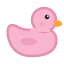
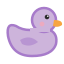
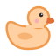

  

  
  
  

 

## 🌷 Where I am right now

  
  
  
  
  
  
  

  

> 🌐 **Currently building `webserv`** — an HTTP/1.1 server in C++98 (non-blocking I/O, `poll()`, CGI, config file parsing). 
> 📚 Finishing the **C++ modules 07 → 09** at the same time.

 

## 🗺️ My 42 journey

| Rank | Projects | Status |
|:---:|---|:---:|
|  **00** | [`libft`](https://github.com/soso0809/Libft) |  |
|  **01** | [`ft_printf`](https://github.com/soso0809/Ft_Printf) · [`get_next_line`](https://github.com/soso0809/get_next_line) · `born2beroot` |  |
|  **02** | [`pipex`](https://github.com/soso0809/pipex) · [`minitalk`](https://github.com/soso0809/minitalk) · [`push_swap`](https://github.com/soso0809/push_swap) · [`so_long`](https://github.com/soso0809/so_long) |  |
|  **03** | [`minishell`](https://github.com/soso0809/minishell) · [`philosophers`](https://github.com/soso0809/philosophers) |  |
|  **04** | [`cub3D`](https://github.com/ooiac/cub3d) · [`NetPractice`](https://github.com/soso0809/netpractice) · [`CPP 00 → 04`](https://github.com/soso0809/cpp) |  |
|  **05** | [`webserv`](https://github.com/soso0809/webserv) · [`CPP 05 → 09`](https://github.com/soso0809/cpp) · `Inception` |  |
|  **06** | `ft_transcendence` |  |

<b>🌼 Rank 05 in detail</b>

 

| Project | Status |
|---|:---:|
| CPP 05 – Exceptions |  |
| CPP 06 – Casts |  |
| CPP 07 – Templates |  |
| CPP 08 – STL containers |  |
| CPP 09 – STL algorithms |  |
| webserv |  |
| Inception |  |

 

## 🧠 Skills learned

| Project | Skills |
|---|---|
|  **libft** | Memory management (`malloc` / `free`), pointers, linked lists, building a static library with a Makefile |
|  **ft_printf** | Variadic functions (`va_list`), formatting & number base conversion |
|  **get_next_line** | File descriptors, `read()` buffering, static variables |
|  **born2beroot** | Virtual machines, Linux administration, users & groups, SSH, firewall (UFW), sudo policy |
|  **pipex** | Processes (`fork`, `execve`, `waitpid`), pipes & redirections (`pipe`, `dup2`) |
|  **minitalk** | UNIX signals (`SIGUSR1` / `SIGUSR2`), bit-level data transfer |
|  **push_swap** | Sorting algorithms, complexity, stacks, optimization |
|  **so_long** | 2D graphics with MiniLibX, event loop, map parsing & path validation |
|  **minishell** | Lexer / parser, environment variables, signals, pipes & redirections, team work with Git |
|  **philosophers** | Threads (`pthread`), mutexes, data races, deadlocks, synchronization |
|  **cub3D** | Raycasting, 3D rendering from a 2D map, trigonometry, textures |
|  **NetPractice** | TCP/IP addressing, subnet masks, routing |
|  **CPP 00 → 04** | OOP: classes, constructors / destructors, operator overloading, inheritance, polymorphism, abstract classes |
|  **CPP 05 → 09** | Exceptions, C++ casts, templates, STL containers, iterators & algorithms |
|  **webserv** | HTTP/1.1 protocol, sockets, non-blocking I/O with `poll()`, config parsing, CGI |
|  **Inception** | Docker, Docker Compose, NGINX, MariaDB, WordPress, TLS |

 

## 🎀 Tools & languages

  
  
  
  
  
  

 

